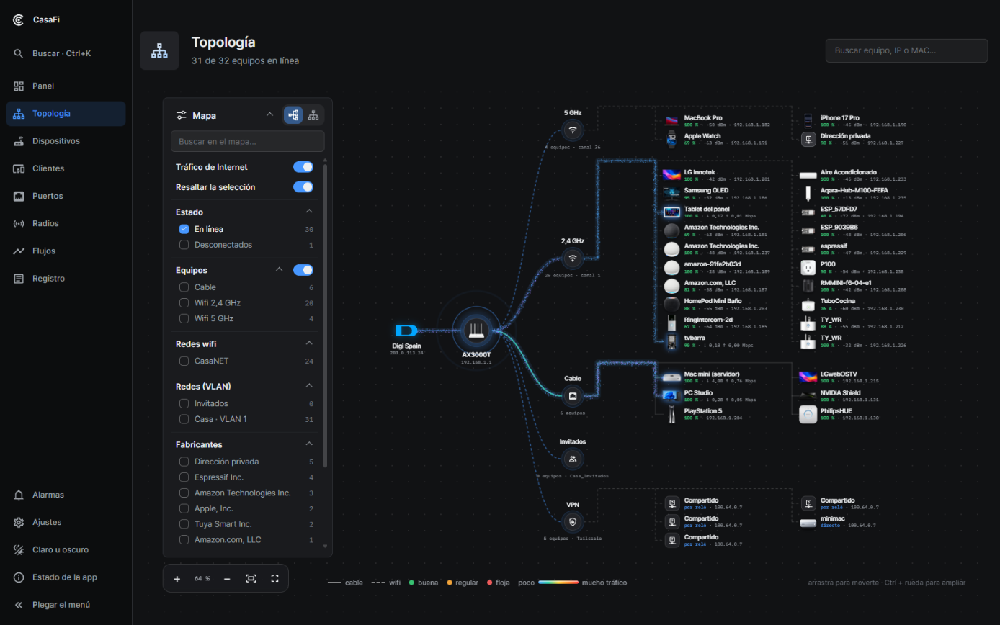
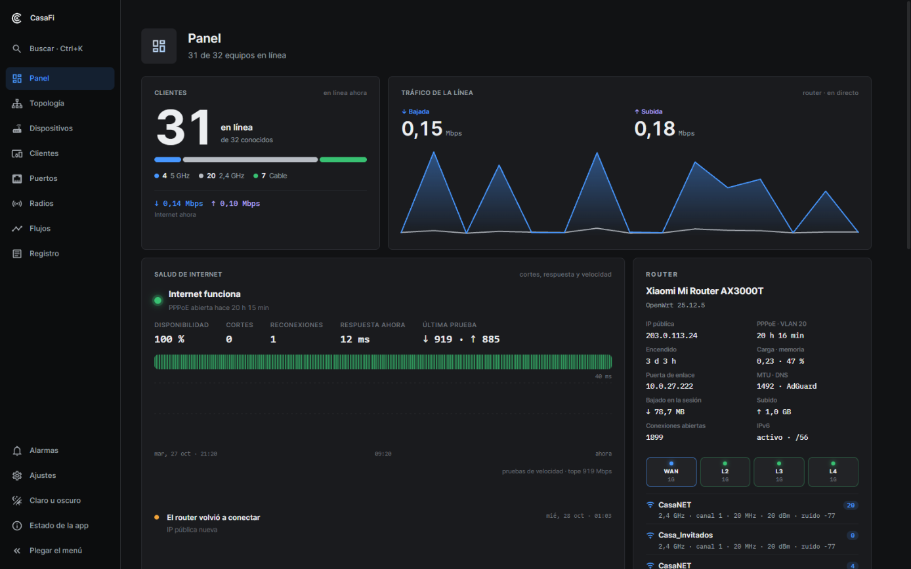
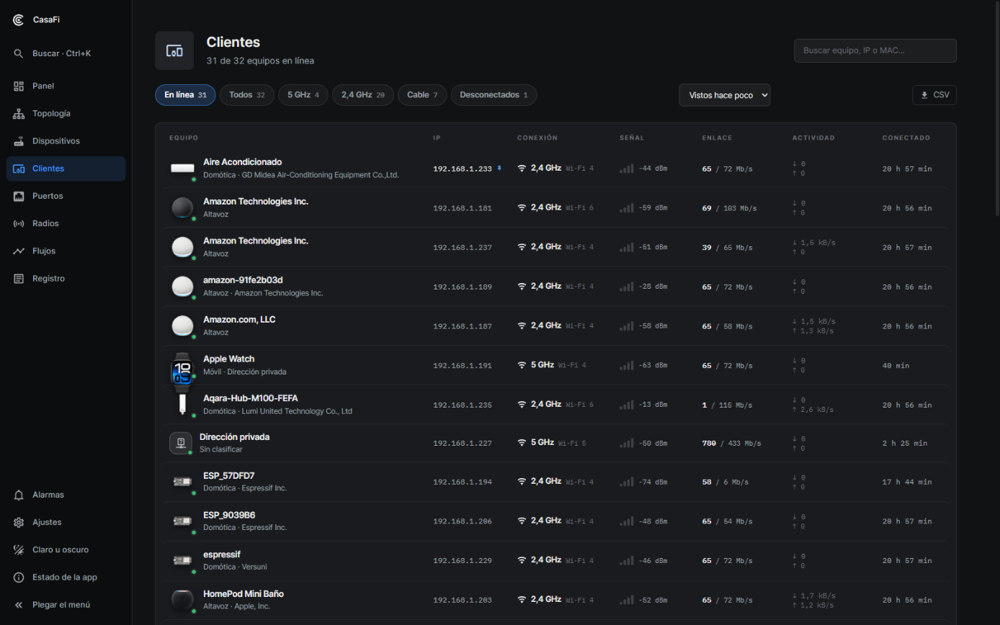
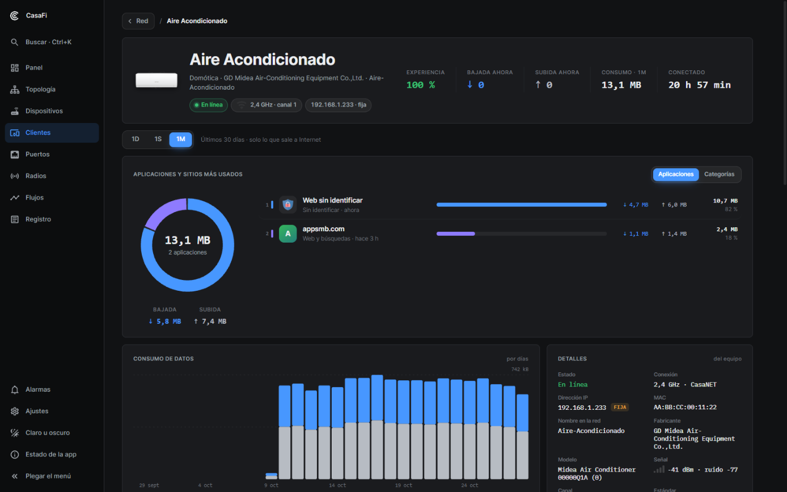
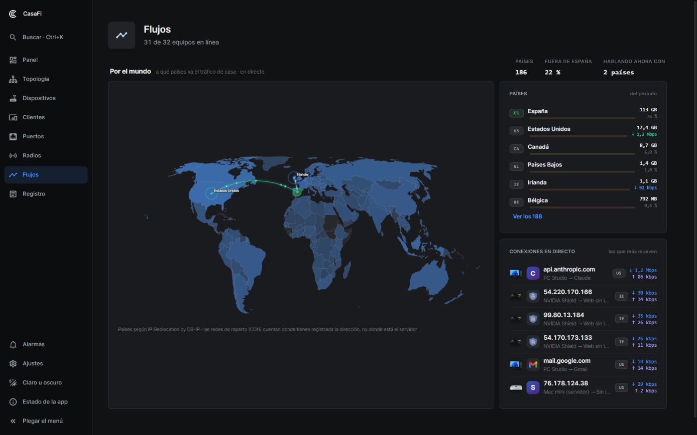
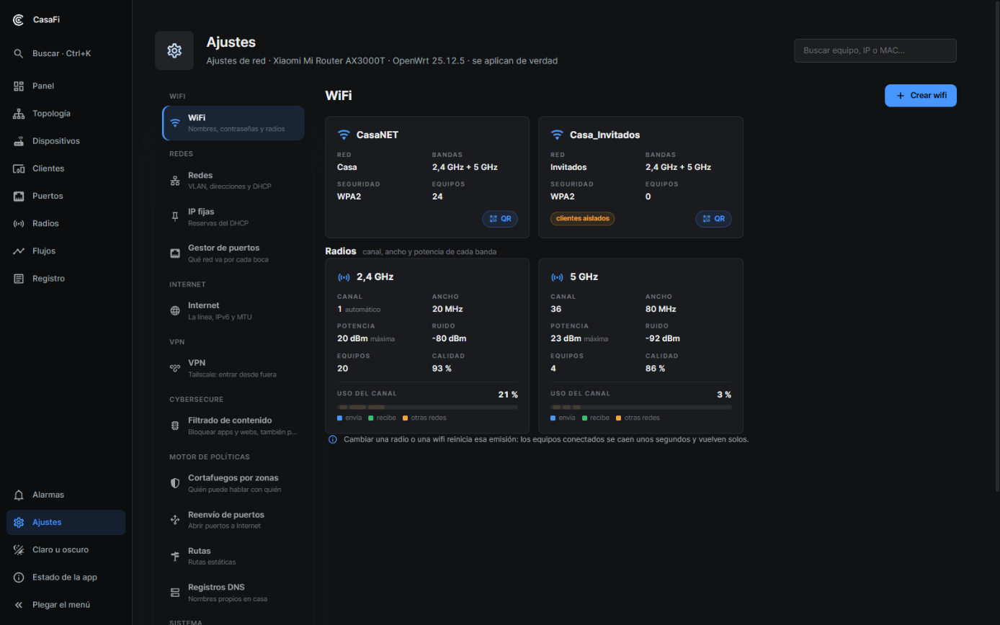

# CasaFi Network

La red de casa al estilo UniFi para cualquier router con **OpenWrt**: mapa de
equipos con el tráfico en directo, clientes, radios, puertos, redes y VLAN,
wifi, cortafuegos, reenvíos de puertos, registro, alarmas… en una app propia
que corre en Docker en cualquier equipo de casa (una Raspberry Pi vale).

> Estado: **en pruebas** (versión 0.4). Si algo falla, descarga el diagnóstico
> (ver abajo) y mándalo.



| | |
|---|---|
|  **Panel**: clientes, tráfico de la línea, salud de Internet y el router |  **Clientes**: cada equipo con su señal, enlace y actividad |
|  **Cada equipo**: aplicaciones que usa, consumo e historial |  **Flujos**: a qué países va el tráfico y las conexiones en directo |
|  **Ajustes**: wifi, redes y VLAN, cortafuegos, reenvíos, VPN… | |

## Qué hace falta

- Un **router con OpenWrt** y su interfaz web (LuCI), con su contraseña de
  administrador. Vale cualquier modelo; está probado con OpenWrt 25.
- Un **equipo encendido en la misma red** con Docker: una Raspberry Pi, un NAS,
  un mini PC… (Linux; en Windows o Mac con Docker Desktop no ve bien la red).

## Instalar

```bash
git clone <esta dirección> casafi      # o descomprime el .zip
cd casafi
docker compose up -d --build
```

Abre `http://<ip-de-ese-equipo>:8102` en el navegador. La **bienvenida** te pide:

1. **Tu router**: su dirección (normalmente `192.168.1.1`) y la contraseña de
   entrar en LuCI. CasaFi la guarda solo en ese equipo.
2. **Una contraseña para CasaFi**: la que pedirán los cambios.
3. **Preparar el router** (recomendado): CasaFi entra por SSH con la misma
   contraseña e instala un pequeño script que solo lee las conexiones, para ver
   qué aplicaciones y webs usa cada equipo. Si no lo haces, todo lo demás
   funciona igual.

## Lo opcional: Ajustes → Aplicación

Lo que no tienes, no estorba: donde haga falta, CasaFi te dice qué conectar.

| Integración | Para qué | Qué pide |
|---|---|---|
| **AdGuard Home** | Escudo DNS (consultas y bloqueos) y qué aplicación usa cada equipo | Su dirección, usuario y contraseña |
| **Tailscale** | La VPN: entrar en casa desde fuera, nodo de salida | Tailscale instalado en este equipo y las dos líneas de `docker-compose.yml` sin comentar |
| **Telegram** | Avisos al móvil (equipos nuevos, cortes de Internet…) | El token de tu bot (@BotFather) y tu número de chat (@userinfobot) |
| **Home Assistant** | Poner nombre a los equipos con lo que ya sabe | Su dirección y un token de larga duración |

En la misma ventana: cambiar de router, volver a prepararlo, cambiar la
contraseña de CasaFi y el idioma (español o inglés).

## Si algo falla

**Ajustes → Aplicación → Diagnóstico → Descargar** genera un texto con la
versión, la configuración (sin contraseñas), lo que ve del router y el registro
de la app de los últimos días. Mándalo a quien te ayude.

También: `docker logs casafi` y el fichero `data/casafi.log`.

## Actualizar

```bash
git pull
docker compose up -d --build
```

La configuración y el historial están en `data/`: se conservan.

## Cómo funciona

- Habla con el router por **ubus** (`http://<router>/ubus`), la misma API que
  usa LuCI; los cambios se hacen como LuCI, con vuelta atrás automática si el
  router deja de contestar.
- Ve la red de casa desde el equipo donde corre (red del anfitrión): la tabla de
  vecinos, su propio tráfico y, si se monta el socket de D-Bus, el mDNS.
- Puerto `8102`; se cambia con `CASALAB_PORT` en `docker-compose.yml`.

## Créditos

- Iconos de interfaz: [Material Design Icons](https://pictogrammers.com/library/mdi/) (Apache 2.0).
- Fuentes: [Inter](https://rsms.me/inter/) e [IBM Plex Mono](https://github.com/IBM/plex) (SIL OFL 1.1).
- Códigos QR: [qrcode-generator](https://github.com/kazuhikoarase/qrcode-generator) (MIT).
- Países por IP: [IP Geolocation by DB-IP](https://db-ip.com) (CC BY 4.0). Mapa del mundo: [world-atlas](https://github.com/topojson/world-atlas) (ISC).
- La interfaz nació a partir del panel propio de su autor sobre
  [Homepage](https://github.com/gethomepage/homepage) (GPL-3.0); el estilo
  imita a UniFi Network.
- Las fotos de algunos modelos de equipos y los iconos de aplicaciones se bajan
  la primera vez de los servidores públicos de Ubiquiti (`static.ui.com`) y son
  suyos. UniFi es una marca de Ubiquiti Inc.; CasaFi no tiene relación con ella.
